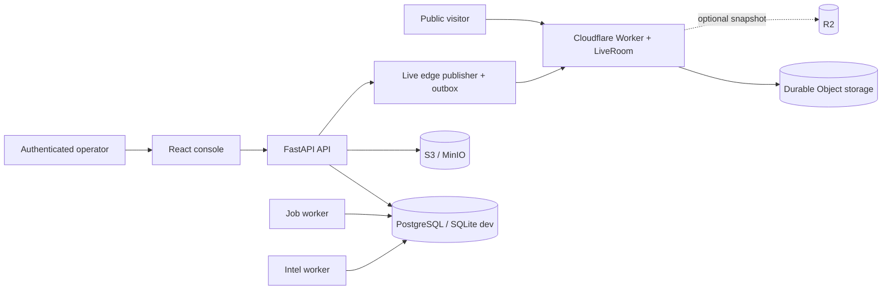

# SeaCommons architecture

Status: canonical architecture description. Last reviewed: 2026-09-22.

SeaCommons is a modular monorepo with four deployable surfaces. It is not a
microservice system: the operational backend is one FastAPI application, with
optional worker processes that share its database and domain code.

## Deployable surfaces

| Surface | Code | Responsibility |
|---|---|---|
| Institutional site | `apps/web/src/site` + `apps/web/src/docs` | Public information site and canonical public docs (`seacommons.org`, `/docs`); React, built with the console in one Vite multi-page build; may read privacy-safe public aggregate/Live contracts but never operator-only data |
| Operational console | `apps/web` | React/Vite UI for Live, Intel, drift, vessels, cases and connectors |
| API and workers | `apps/api` | Authentication, ingestion, domain policy, persistence, jobs and integrations |
| Public Live edge | `apps/edge` | Privacy-filtered public snapshot and WebSocket distribution |



## Backend boundaries

HTTP routes live under `core/api/routes`. Routes parse transport input and
delegate Live/Intel decisions to `core/live` and `core/intel` services. Shared
vocabulary and validation models live under `core/domain`; provider-specific
code remains in `core/ingestion`, `core/integrations`, `core/intel` and related
subsystems.

The intended dependency direction is:

```text
route / process entrypoint
        -> domain service / projection
        -> store or integration adapter
        -> database / provider
```

Domain policy must not move back into route handlers. In particular, public
Live publication is governed by `core/domain/live_contracts.py`,
`core/intel/public_policy.py`, `core/intel/public_geometry.py` and
`core/live/projection.py`.

## Supported process topologies

Development can run the API, intel monitors and scheduler in one process. A
production deployment separates responsibilities:

- API: `core.api.main`, with `INTEL_MONITORS_ENABLED=false`;
- intel worker: `python -m core.intel_worker_main`;
- durable job worker: `python -m core.worker` with `JOB_EXECUTION_MODE=queue`;
- edge publisher: `python -m core.live_edge_publisher`.

The API-side `intel-db-sync` thread refreshes its read cache from the shared
database when monitors run elsewhere. Its success, failure streak and recovery
are exported as Prometheus metrics. Production startup fails if authentication,
OIDC, object storage or queued job execution are not configured.

## Storage ownership

- PostgreSQL is the production system of record. SQLite is supported for local
  development, tests and the publisher outbox.
- S3-compatible object storage owns attachments and large artifacts.
- The in-process intel store is a cache/read model backed by the database; it is
  not an independent source of truth.
- The institutional site may read canonical public aggregate status and privacy-filtered Live projections; it must not implement a parallel evidence or analytics pipeline.
- Cloudflare Durable Object storage owns the ephemeral public Live snapshot.
  Optional R2 storage mirrors the latest public snapshot only.
- Browser storage is a degraded/offline cache and never authoritative.

## Architectural invariants

- User-originated signals are private by default.
- Only the canonical public projection may cross into Public Live.
- Unknown source policies and contract-invalid payloads fail closed.
- Missing coordinates stay missing; approximate/area geometry carries explicit
  precision metadata.
- Duplicate edge delivery is idempotent and one incident has one visible latest
  version.
- A stale version cannot resurrect a newer removed/resolved incident.
- Source heartbeat freshness and event recency are separate states.

The executable tests for these invariants live in `tests/test_live_contracts.py`,
`tests/test_live_feed.py`, `tests/test_live_edge_publisher.py` and
`apps/edge/src/live.test.js`.

## Related canonical documents

- [Data flow](DATA_FLOW.md)
- [Security model](SECURITY_MODEL.md)
- [Realtime architecture](REALTIME_ARCHITECTURE.md)
- [Contract catalogue](contracts/README.md)
- [Production operations](PRODUCTION_RUNBOOK.md)

Historical audits and deployment evidence are indexed in [docs/README.md](README.md).

## Canonical investigation upgrade (October 2026)

A **single analysis chain** is authoritative; new UX views must not establish shadow stores or duplicate detector APIs.

| Concern | Canonical existing owner | Rule |
|---|---|---|
| Raw AIS positions | `VesselTrackDB` through `core.vessels.track_store` | Timestamps and original receiving source preserved; 60-day retention is not a permanent archive |
| Derived maritime evidence | `MaritimeEpisodeDB` with its evidence/feature IDs | Preserve episode identity; no second case table |
| Investigative hypothesis | `InvestigationHypothesisDB` and hypothesis publication gate | The state, counter-indicators, and independent evidence lineages remain authoritative |
| Play report | `/api/v1/play/incidents/{id}/timeline` | Extend the existing canonical dossier payload and report UI, not a parallel report endpoint |
| Evidence track | `voyage_evidence` in the existing Play dossier | Reuse track-store readings, mark AIS gaps as absent stored fixes and port calls as inferred, bounded to 7 days and 3 already-published vessel identities |
| Live | Existing publication projections | Operational horizon, not the lifetime repository of all history |

**Privacy gate:** Never promote MMSIs obtained only through internal radio associations into public investigations. A public voyage enrichment may use only expressly published hypothesis case subjects; review-ready cases and episode-only views stay redacted. No raw classified radio or internal evidence references may be smuggled through `voyage_evidence`.

**Evidence validity:** A gap between two retained AIS fixes may come from collection or retention. A drawn segment does not assert the precise route and a port call does not establish loading/unloading. The UI historical cutoff must constrain visible AIS records. The reception expectation model and existing episode evidence stages remain distinct from vessel intent or cargo hypotheses.

**Not yet built:** Permanent cold-storage raw observations; independently calibrated AIS-gap benchmark; multi-seed physical humanitarian macro-drift; comprehensive external cargo manifests and primary sanctions grounds; independent review of 20 real-world incidents. These are milestones, not already delivered features.

### AIS raw-track cold retention (implementation, activation gated)

`core.vessels.track_store.TrackStore.prune` now exports bounded, immutable `cold/ais-tracks/v1/<year>/<id-range>-<sha256>.json.gz` records through `core.object_store` **before** deleting the corresponding original hot-table rows. It retrieves the compressed artifact and compares SHA-256 prior to a committed delete; storage failure preserves SQL rows. This extends the canonical track history lifecycle rather than creating a parallel DB/service.

Deployment gate: **object-store connectivity must succeed from the Oracle VM** and a retrieval/replay reader must be validated before this can be called a fully searchable permanent archive. As of 2026-10-14 the configured Cloudflare R2 endpoint fails TLS handshake from the VM, so cold retention is not operational. Never claim archived history exists without a completed successful batch and verifiable object key. The 60-day hot-store limit is not retroactive recovery of observations already deleted.

### Remote OpenDrift resilience

`core.worker_service` remains the **only** compute-worker implementation and `core.drift.engine._remote_compute` is its canonical client. When a dedicated worker is operational, set `DRIFT_WORKER_URL`, `DRIFT_WORKER_SECRET` and `DRIFT_WORKER_REQUIRE_REMOTE=true` on the API. Then a worker failure becomes an explicit retriable computation failure, rather than a silent local OpenDrift/CMEMS run within the API memory cgroup. The flag defaults false until the worker is independently deployed and validated. Do not configure the same host as the remote worker and describe it as memory isolation. A real multi-origin probabilistic area ensemble is not provided by this flag alone.
